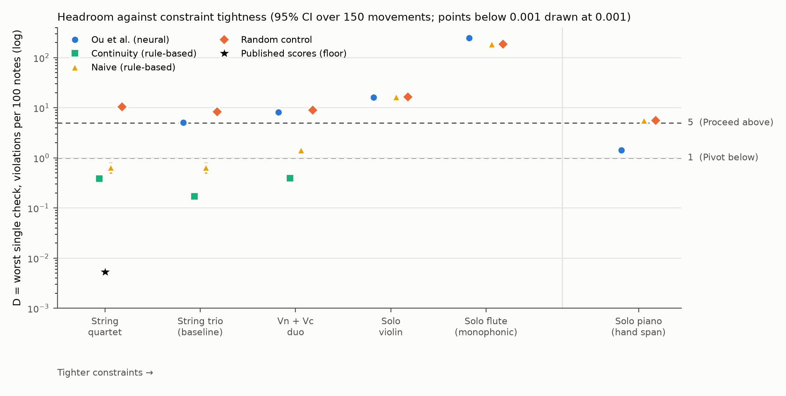

# HEADROOM: how often do existing arrangement systems produce unplayable output?

> **Systems measured:** Ou et al. (NeurIPS 2025, released weights) is the primary, neural system and
> drives the decision. The rule-based assigners are reported alongside and labelled "rule-based"
> everywhere; their numbers are headroom against rule-based systems only. The Anticipatory Music
> Transformer is secondary (generation, not arrangement) and never decides.

## Decision (pre-registered rule, DECISION.md + amendment A1)

- Baseline regime: string trio. Primary system: Ou et al. band arranger (neural).
- **D = 5.12 violations per 100 notes** (worst single check: `chord_size`), 95% score-bootstrap CI **[4.65, 5.59]**.
- Threshold band of the CI: **Undecided**. Positive control CI [7.88, 8.71] (valid: entirely above 5). Sparse: no.
- **Verdict: Undecided.**

## Evaluation set and pairing

- 150 movements: seeded random sample (seed 0) of the 626 non-dev OpenScore string-quartet
  movements (`headroom/data/eval_set.json`). None was used for assigner tuning or transition
  calibration; upper ranges were fitted on the full corpus, so source pitches lie inside the string ranges.
- **FROM:** the full four-part quartet (grace notes dropped). **FOR:** the regime's ensemble. Every regime
  except piano is a reduction.
- Out of distribution for both neural systems (trained on Lakh MIDI, mostly pop). The claim is limited to
  these systems on classical quartet sources.
- Checker: tag `checker-v1.1` (code identical to `checker-v1`). Outputs present: ou_band/trio 150/150, ou_band/duo 150/150, ou_band/solo_violin 150/150, ou_band/solo_flute 150/150, ou_piano/piano 150/150, amt/trio 150/150.

## Sweep: D per regime and system

| Regime | System | D | 95% CI | worst check | verdict band |
|---|---|---|---|---|---|
| String quartet (Vn Vn Va Vc) | Continuity (rule-based) | 0.384 | [0.31, 0.46] | range |  |
| String quartet (Vn Vn Va Vc) | Naive (rule-based) | 0.644 | [0.49, 0.82] | chord_size |  |
| String quartet (Vn Vn Va Vc) | Random control | 10.358 | [9.89, 10.82] | range |  |
| String quartet (Vn Vn Va Vc) | Published scores (floor) | 0.005 | [0.00, 0.01] | transition |  |
| String trio (Vn Va Vc), baseline | Ou et al. band arranger (neural) | 5.117 | [4.65, 5.59] | chord_size | Undecided |
| String trio (Vn Va Vc), baseline | Ou et al. band, duplicates collapsed (sensitivity) | 4.209 | [3.84, 4.66] | chord_size |  |
| String trio (Vn Va Vc), baseline | Anticipatory Music Transformer (secondary; generation) | 0.088 | [0.04, 0.16] | range |  |
| String trio (Vn Va Vc), baseline | AMT, duplicates collapsed (sensitivity) | 0.088 | [0.04, 0.16] | range |  |
| String trio (Vn Va Vc), baseline | Continuity (rule-based) | 0.172 | [0.14, 0.21] | range |  |
| String trio (Vn Va Vc), baseline | Naive (rule-based) | 0.647 | [0.49, 0.82] | chord_size |  |
| String trio (Vn Va Vc), baseline | Random control | 8.297 | [7.88, 8.71] | range |  |
| Vn + Vc duo | Ou et al. band arranger (neural) | 8.182 | [7.71, 8.73] | chord_size | Proceed |
| Vn + Vc duo | Ou et al. band, duplicates collapsed (sensitivity) | 7.949 | [7.47, 8.43] | range |  |
| Vn + Vc duo | Continuity (rule-based) | 0.393 | [0.32, 0.47] | range |  |
| Vn + Vc duo | Naive (rule-based) | 1.430 | [1.17, 1.70] | chord_size |  |
| Vn + Vc duo | Random control | 9.023 | [8.63, 9.41] | range |  |
| Solo violin | Ou et al. band arranger (neural) | 16.087 | [15.34, 16.84] | range | Proceed |
| Solo violin | Ou et al. band, duplicates collapsed (sensitivity) | 16.262 | [15.53, 16.97] | range |  |
| Solo violin | Naive (rule-based) | 16.497 | [15.80, 17.19] | range |  |
| Solo violin | Random control | 16.497 | [15.80, 17.19] | range |  |
| Solo flute (monophonic) | Ou et al. band arranger (neural) | 249.955 | [219.86, 295.01] | simultaneity | Proceed |
| Solo flute (monophonic) | Ou et al. band, duplicates collapsed (sensitivity) | 207.257 | [198.11, 216.53] | simultaneity |  |
| Solo flute (monophonic) | Naive (rule-based) | 185.125 | [180.40, 189.68] | simultaneity |  |
| Solo flute (monophonic) | Random control | 185.125 | [180.40, 189.68] | simultaneity |  |
| Solo piano (hand span) | Ou et al. piano arranger (neural) | 1.422 | [1.30, 1.55] | hand_span | Tighten |
| Solo piano (hand span) | Ou et al. piano, duplicates collapsed (sensitivity) | 1.435 | [1.31, 1.57] | hand_span |  |
| Solo piano (hand span) | Naive (rule-based) | 5.639 | [5.06, 6.21] | hand_span |  |
| Solo piano (hand span) | Random control | 5.639 | [5.06, 6.21] | hand_span |  |

Bands are given for the primary system only; non-baseline bands are secondary findings (DECISION.md).

## Per check type (never summed): violations per 100 output notes, with 95% CI

| Regime | System | simult. | range | chord | span | trans. |
|---|---|---|---|---|---|---|
| quartet | continuity | 0.000 [0.00, 0.00] | 0.384 [0.31, 0.46] | 0.000 [0.00, 0.00] | 0.000 [0.00, 0.00] | 0.016 [0.01, 0.02] |
| quartet | naive | 0.000 [0.00, 0.00] | 0.000 [0.00, 0.00] | 0.644 [0.49, 0.82] | 0.000 [0.00, 0.00] | 0.000 [0.00, 0.00] |
| quartet | control | 0.000 [0.00, 0.00] | 10.358 [9.89, 10.82] | 0.089 [0.07, 0.11] | 0.000 [0.00, 0.00] | 1.338 [1.21, 1.47] |
| quartet | floor | 0.000 [0.00, 0.00] | 0.000 [0.00, 0.00] | 0.000 [0.00, 0.00] | 0.000 [0.00, 0.00] | 0.005 [0.00, 0.01] |
| trio | ou_band | 0.000 [0.00, 0.00] | 4.184 [3.71, 4.67] | 5.117 [4.65, 5.59] | 0.000 [0.00, 0.00] | 0.233 [0.19, 0.28] |
| trio | ou_band_dedup | 0.000 [0.00, 0.00] | 3.974 [3.63, 4.32] | 4.209 [3.77, 4.66] | 0.000 [0.00, 0.00] | 0.222 [0.19, 0.26] |
| trio | amt | 0.000 [0.00, 0.00] | 0.088 [0.04, 0.16] | 0.021 [0.00, 0.05] | 0.000 [0.00, 0.00] | 0.008 [0.00, 0.02] |
| trio | amt_dedup | 0.000 [0.00, 0.00] | 0.088 [0.04, 0.16] | 0.020 [0.00, 0.05] | 0.000 [0.00, 0.00] | 0.008 [0.00, 0.02] |
| trio | continuity | 0.000 [0.00, 0.00] | 0.172 [0.14, 0.21] | 0.011 [0.00, 0.02] | 0.000 [0.00, 0.00] | 0.041 [0.03, 0.05] |
| trio | naive | 0.000 [0.00, 0.00] | 0.000 [0.00, 0.00] | 0.647 [0.49, 0.82] | 0.000 [0.00, 0.00] | 0.000 [0.00, 0.00] |
| trio | control | 0.000 [0.00, 0.00] | 8.297 [7.88, 8.71] | 0.225 [0.18, 0.27] | 0.000 [0.00, 0.00] | 1.342 [1.22, 1.47] |
| duo | ou_band | 0.000 [0.00, 0.00] | 7.824 [7.33, 8.32] | 8.182 [7.62, 8.73] | 0.000 [0.00, 0.00] | 0.421 [0.35, 0.50] |
| duo | ou_band_dedup | 0.000 [0.00, 0.00] | 7.949 [7.46, 8.43] | 7.142 [6.55, 7.72] | 0.000 [0.00, 0.00] | 0.420 [0.37, 0.48] |
| duo | continuity | 0.000 [0.00, 0.00] | 0.393 [0.32, 0.47] | 0.093 [0.06, 0.14] | 0.000 [0.00, 0.00] | 0.069 [0.05, 0.08] |
| duo | naive | 0.000 [0.00, 0.00] | 0.000 [0.00, 0.00] | 1.430 [1.17, 1.70] | 0.000 [0.00, 0.00] | 0.035 [0.03, 0.05] |
| duo | control | 0.000 [0.00, 0.00] | 9.023 [8.63, 9.41] | 0.783 [0.65, 0.92] | 0.000 [0.00, 0.00] | 0.740 [0.66, 0.82] |
| solo_violin | ou_band | 0.000 [0.00, 0.00] | 16.087 [15.34, 16.84] | 11.303 [10.52, 12.12] | 0.000 [0.00, 0.00] | 0.399 [0.34, 0.47] |
| solo_violin | ou_band_dedup | 0.000 [0.00, 0.00] | 16.262 [15.53, 16.97] | 10.497 [9.65, 11.39] | 0.000 [0.00, 0.00] | 0.413 [0.35, 0.48] |
| solo_violin | naive | 0.000 [0.00, 0.00] | 16.497 [15.80, 17.19] | 5.704 [4.88, 6.54] | 0.000 [0.00, 0.00] | 0.071 [0.05, 0.10] |
| solo_violin | control | 0.000 [0.00, 0.00] | 16.497 [15.80, 17.19] | 5.704 [4.88, 6.54] | 0.000 [0.00, 0.00] | 0.071 [0.05, 0.10] |
| solo_flute | ou_band | 249.955 [219.86, 295.01] | 28.679 [27.73, 29.64] | 0.000 [0.00, 0.00] | 0.000 [0.00, 0.00] | 0.000 [0.00, 0.00] |
| solo_flute | ou_band_dedup | 207.257 [198.11, 216.53] | 29.025 [28.13, 29.92] | 0.000 [0.00, 0.00] | 0.000 [0.00, 0.00] | 0.000 [0.00, 0.00] |
| solo_flute | naive | 185.125 [180.40, 189.68] | 29.969 [29.14, 30.80] | 0.000 [0.00, 0.00] | 0.000 [0.00, 0.00] | 0.000 [0.00, 0.00] |
| solo_flute | control | 185.125 [180.40, 189.68] | 29.969 [29.14, 30.80] | 0.000 [0.00, 0.00] | 0.000 [0.00, 0.00] | 0.000 [0.00, 0.00] |
| piano | ou_piano | 0.000 [0.00, 0.00] | 0.429 [0.03, 1.14] | 0.536 [0.44, 0.64] | 1.422 [1.30, 1.55] | 0.000 [0.00, 0.00] |
| piano | ou_piano_dedup | 0.000 [0.00, 0.00] | 0.094 [0.03, 0.19] | 0.399 [0.32, 0.49] | 1.435 [1.31, 1.57] | 0.000 [0.00, 0.00] |
| piano | naive | 0.000 [0.00, 0.00] | 0.000 [0.00, 0.00] | 0.018 [0.01, 0.03] | 5.639 [5.06, 6.21] | 0.000 [0.00, 0.00] |
| piano | control | 0.000 [0.00, 0.00] | 0.000 [0.00, 0.00] | 0.018 [0.01, 0.03] | 5.639 [5.06, 6.21] | 0.000 [0.00, 0.00] |

Simultaneity applies only to monophonic instruments (flute) and hand span only to keyboard (piano);
elsewhere they are 0 by construction. Transition is off for flute and piano (A1.4).

## Note counts against the source (sparsity guard, A1.6)

Retention per target part = output notes in that part / notes of its reference source part (violin → Vn1,
viola → Va, cello → Vc, flute → Vn1, piano → all four parts). Sparse = any part below 0.8.

| Regime | System | output notes | source notes | total retention | per-part retention | sparse | off-ensemble notes | bars truncated |
|---|---|---|---|---|---|---|---|---|
| quartet | continuity | 523,196 | 523,196 | 1.00 | 0.96, 0.99, 1.03, 1.03 | no |  |  |
| quartet | naive | 523,196 | 523,196 | 1.00 | 0.03, 0.68, 1.20, 2.61 | yes |  |  |
| quartet | control | 523,196 | 523,196 | 1.00 | 0.86, 0.94, 1.02, 1.26 | no |  |  |
| quartet | floor | 523,196 | 523,196 | 1.00 | 1.00, 1.00, 1.00, 1.00 | no |  |  |
| trio | ou_band | 773,065 | 523,196 | 1.48 | 2.17, 1.70, 2.15 | no | 1888 | 80 |
| trio | ou_band_dedup | 704,284 | 523,196 | 1.35 | 1.96, 1.55, 1.99 | no | 1888 | 80 |
| trio | amt | 51,242 | 73,135 | 0.70 | 1.01, 0.92, 0.93 | no | 2247 |  |
| trio | amt_dedup | 51,111 | 73,135 | 0.70 | 1.01, 0.92, 0.93 | no | 2247 |  |
| trio | continuity | 523,196 | 523,196 | 1.00 | 1.24, 1.41, 1.47 | no |  |  |
| trio | naive | 523,196 | 523,196 | 1.00 | 0.64, 1.20, 2.61 | yes |  |  |
| trio | control | 523,196 | 523,196 | 1.00 | 1.14, 1.37, 1.67 | no |  |  |
| duo | ou_band | 703,295 | 523,196 | 1.34 | 2.89, 2.51 | no | 1638 | 31 |
| duo | ou_band_dedup | 645,851 | 523,196 | 1.23 | 2.65, 2.31 | no | 1638 | 31 |
| duo | continuity | 523,196 | 523,196 | 1.00 | 1.83, 2.32 | no |  |  |
| duo | naive | 523,196 | 523,196 | 1.00 | 1.15, 3.33 | no |  |  |
| duo | control | 523,196 | 523,196 | 1.00 | 1.71, 2.50 | no |  |  |
| solo_violin | ou_band | 506,374 | 523,196 | 0.97 | 3.31 | no | 350 | 6 |
| solo_violin | ou_band_dedup | 478,678 | 523,196 | 0.91 | 3.13 | no | 350 | 6 |
| solo_violin | naive | 523,196 | 523,196 | 1.00 | 3.42 | no |  |  |
| solo_violin | control | 523,196 | 523,196 | 1.00 | 3.42 | no |  |  |
| solo_flute | ou_band | 439,161 | 523,196 | 0.84 | 2.87 | no | 40931 | 17 |
| solo_flute | ou_band_dedup | 419,640 | 523,196 | 0.80 | 2.75 | no | 40931 | 17 |
| solo_flute | naive | 523,196 | 523,196 | 1.00 | 3.42 | no |  |  |
| solo_flute | control | 523,196 | 523,196 | 1.00 | 3.42 | no |  |  |
| piano | ou_piano | 389,192 | 523,196 | 0.74 | 0.74 | yes | 660 | 7 |
| piano | ou_piano_dedup | 378,419 | 523,196 | 0.72 | 0.72 | yes | 660 | 7 |
| piano | naive | 523,196 | 523,196 | 1.00 | 1.00 | no |  |  |
| piano | control | 523,196 | 523,196 | 1.00 | 1.00 | no |  |  |

Rule-based systems and the control assign every source note, so their total retention is 1 and their
per-part retention only shows how they spread notes. Retention matters for the neural systems. AMT is
compared with the same 32-bar window of the source.

## Per-score distribution of the primary system (is the rate driven by a few pieces?)

| Regime | System | check | scores with any | median per score | p90 | max | share in worst 5% | worst movements |
|---|---|---|---|---|---|---|---|---|
| trio | ou_band | range | 150 | 3.32 | 6.77 | 12.97 | 0.23 | Cras,_Jean__String_Quartet__sq25403263__… (12.3); Janáček,_Leoš__String_Quartet_No.2_“Inti… (13.0); Cherubini,_Luigi__String_Quartet_No.1__s… (11.6) |
| trio | ou_band | chord_size | 150 | 4.91 | 8.50 | 16.31 | 0.17 | Brahms,_Johannes__String_Quartet_No.1,_O… (8.5); Cherubini,_Luigi__String_Quartet_No.1__s… (12.3); Bridge,_Frank__String_Quartet_No.2,_H.11… (9.0) |
| trio | ou_band | transition | 134 | 0.13 | 0.47 | 1.69 | 0.28 | Janáček,_Leoš__String_Quartet_No.2_“Inti… (1.7); Brahms,_Johannes__String_Quartet_No.1,_O… (0.6); Cras,_Jean__String_Quartet__sq25403263__… (0.6) |
| trio | amt | range | 18 | 0.00 | 0.14 | 6.48 | 0.78 | Dvořák,_Antonín__String_Quartet_No.12,_O… (6.5); Mendelssohn,_Felix__String_Quartet_No.2,… (2.0); Mozart,_Wolfgang_Amadeus__String_Quartet… (2.5) |
| trio | amt | chord_size | 4 | 0.00 | 0.00 | 3.97 | 1.00 | Beethoven,_Ludwig_van__String_Quartet_No… (4.0); Brahms,_Johannes__String_Quartet_No.1,_O… (0.6); Cras,_Jean__String_Quartet__sq25403263__… (0.5) |
| trio | amt | transition | 3 | 0.00 | 0.00 | 0.28 | 1.00 | Brahms,_Johannes__String_Quartet_No.1,_O… (0.3); Haydn,_Joseph__String_Quartet_in_G_major… (0.2); Koechlin,_Charles__String_Quartet_No.1,_… (0.1) |
| duo | ou_band | range | 150 | 6.98 | 11.67 | 17.17 | 0.16 | Schubert,_Franz__String_Quartet_in_D_min… (10.7); Bartók,_Béla__String_Quartet_No.2,_Op.17… (11.1); Kalliwoda,_Johann_Wenzel__String_Quartet… (11.6) |
| duo | ou_band | chord_size | 150 | 8.42 | 12.22 | 18.09 | 0.14 | Bartók,_Béla__String_Quartet_No.2,_Op.17… (10.6); Mozart,_Wolfgang_Amadeus__String_Quartet… (10.2); Kalliwoda,_Johann_Wenzel__String_Quartet… (10.7) |
| duo | ou_band | transition | 145 | 0.32 | 0.78 | 3.87 | 0.25 | Janáček,_Leoš__String_Quartet_No.2_“Inti… (3.9); Smetana,_Bedřich__String_Quartet_No.1__s… (1.7); Brahms,_Johannes__String_Quartet_No.1,_O… (1.0) |
| solo_violin | ou_band | range | 150 | 15.25 | 22.35 | 33.70 | 0.15 | Schubert,_Franz__String_Quartet_in_D_min… (20.8); Bartók,_Béla__String_Quartet_No.2,_Op.17… (20.8); Bridge,_Frank__String_Quartet_No.1,_H.70… (30.0) |
| solo_violin | ou_band | chord_size | 150 | 11.34 | 17.49 | 25.38 | 0.15 | Mozart,_Wolfgang_Amadeus__String_Quartet… (16.9); Bartók,_Béla__String_Quartet_No.2,_Op.17… (14.3); Haydn,_Joseph__String_Quartet_in_C_major… (16.9) |
| solo_violin | ou_band | transition | 140 | 0.25 | 0.84 | 3.31 | 0.23 | Smetana,_Bedřich__String_Quartet_No.1__s… (1.9); Dvořák,_Antonín__String_Quartet_No.11,_O… (1.3); Haydn,_Joseph__String_Quartet_in_D_minor… (3.3) |
| solo_flute | ou_band | simultaneity | 150 | 213.09 | 307.20 | 1938.73 | 0.22 | Janáček,_Leoš__String_Quartet_No.2_“Inti… (1938.7); Brahms,_Johannes__String_Quartet_No.1,_O… (578.0); Bartók,_Béla__String_Quartet_No.2,_Op.17… (338.6) |
| solo_flute | ou_band | range | 150 | 28.61 | 36.03 | 47.32 | 0.14 | Schubert,_Franz__String_Quartet_in_D_min… (32.7); Kalliwoda,_Johann_Wenzel__String_Quartet… (39.1); Franck,_César__String_Quartet__sq2665277… (33.0) |
| piano | ou_piano | range | 35 | 0.00 | 0.07 | 26.54 | 0.97 | Grieg,_Edvard__String_Quartet_No.1,_Op.2… (26.5); Haydn,_Joseph__String_Quartet_in_C_major… (3.9); Reger,_Max__String_Quartet_No.4,_Op.109_… (13.3) |
| piano | ou_piano | chord_size | 124 | 0.27 | 1.25 | 2.43 | 0.27 | Bartók,_Béla__String_Quartet_No.2,_Op.17… (1.6); Zemlinsky,_Alexander_von__String_Quartet… (2.2); Strauss,_Richard__String_Quartet_in_A_ma… (2.1) |
| piano | ou_piano | hand_span | 148 | 1.28 | 2.50 | 4.42 | 0.16 | Cherubini,_Luigi__String_Quartet_No.1__s… (2.2); Beethoven,_Ludwig_van__String_Quartet_No… (2.4); Brahms,_Johannes__String_Quartet_No.1,_O… (2.4) |

## Where the primary system's violations are (by part; range split by direction)

- **trio / ou_band:** by check:part {'chord_size:0': 19309, 'chord_size:1': 9796, 'chord_size:2': 10453, 'range:0': 20770, 'range:1': 8531, 'range:2': 3042, 'transition:0': 554, 'transition:1': 366, 'transition:2': 883}; range by direction:part {'above:0': 21, 'above:1': 84, 'above:2': 436, 'below:0': 20749, 'below:1': 8447, 'below:2': 2606}
- **duo / ou_band:** by check:part {'chord_size:0': 39499, 'chord_size:1': 18042, 'range:0': 52879, 'range:1': 2147, 'transition:0': 1324, 'transition:1': 1640}; range by direction:part {'above:0': 13, 'above:1': 971, 'below:0': 52866, 'below:1': 1176}
- **solo_violin / ou_band:** by check:part {'chord_size:0': 57234, 'range:0': 81458, 'transition:0': 2022}; range by direction:part {'above:0': 24, 'below:0': 81434}
- **solo_flute / ou_band:** by check:part {'range:0': 125948, 'simultaneity:0': 1097707}; range by direction:part {'above:0': 136, 'below:0': 125812}
- **piano / ou_piano:** by check:part {'chord_size:0': 2085, 'hand_span:0': 5533, 'range:0': 1670}; range by direction:part {'above:0': 60, 'below:0': 1610}

## Reproduce

    headroom/run_all.sh

Steps: export sources (checker env) → generate (model env, `headroom/env.md`) → measure, figure, report
(checker env). Raw per-score results: `headroom/results/per_score.csv`; pooled statistics:
`headroom/results/summary.json`; raw model outputs: `headroom/data/out/` (archived as
`headroom/results/outputs.tar.gz`).
