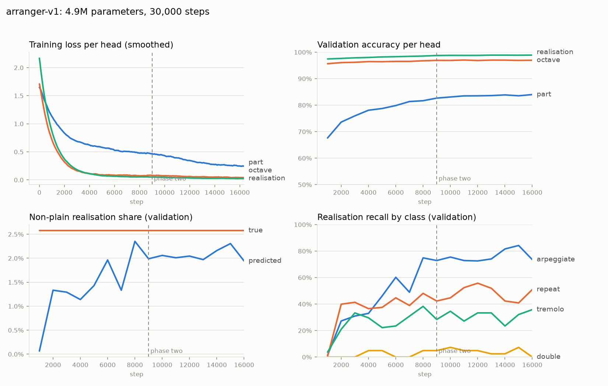

# The arranger model (model block, Steps 2–6)

A supervised arranger that assigns each source note to a target part (or drops it), an
octave shift and a string realisation. It is decoded iteratively, with or without masking
by the frozen hard-tier checker. There is no reward function, rejection sampling or RL in
this block. That is the next block, and this model is its starting point.

Run: `arranger-v1` (checkpoint `model/results/arranger-v1/checkpoint.pt`, 30,000 steps).
Checker: **checker-v4** (frozen, tag `checker-v4`). Metrics: **METRICS 1.3.0-draft**.
Decisions taken under "proceed with all steps" are logged in REVIEW.md R23–R27.

## 1. Data and augmentation (Step 2; `model/augment.py`, `model/export_data.py`)

- **Movements:** OpenScore string quartets.
  - Train: 476 movements.
  - Validation: 61 (the dev split, crc32 % 10 == 0).
  - The 150 headroom evaluation movements are excluded and never seen in training.
- **Training example:** a 16-quarter window plus the previous 8 quarters as committed
  context, which is exactly the decoding layout.
- **Target ensemble per window:**

  | Ensemble | Share | Parts |
  |---|---|---|
  | Quartet | 50% | the true parts |
  | Trio | 30% | Vn1+Vn2 → violin, Va, Vc |
  | Duo | 20% | Vn1+Vn2 → violin, Va+Vc → cello |

  A note outside its target instrument's range gets the nearest octave shift that fits,
  else DROP. A unison duplicate keeps its longest copy and drops the others.
- **Realisation labels.** Every transformation is reversible: the input is the transformed
  score, the target is the original, and the inverse op is the label (R23).
  - **Collapse of real string figuration**, each detected instance with probability 0.5:
    - repeated 8ths → one note, label *repeat*;
    - repeated 16ths → one note, label *tremolo*;
    - ascending 3–4-note arpeggio with intervals ≥ 3 semitones → block chord, label *arpeggiate*;
    - octave double stop → lower note, label *double*.
  - **Keyboard octave doubling** added to the input (p = 0.25 per window). The copies are labelled DROP.
  - **Register displacement** of one source part by ±12 (p = 0.25). Its notes are labelled with the inverse shift.
  - Not added: Alberti patterns. They are not a string idiom, and no op produces them.
- **`expand()`** turns labels back into notes:
  - repeat = 8ths; tremolo = 16ths, with the last note absorbing the remainder;
  - arpeggiate = equal subdivision in ascending order; double = plus the upper octave.

  For collapsed figuration this round trip is exact (`tests/test_model_augment.py`).

**Label statistics** (20,000 sampled windows, 1.63M predicted notes; `model/results/label_stats.json`):

| Label | Share of notes |
|---|---|
| plain | 97.2% |
| arpeggiate | 1.99% |
| repeat | 0.41% |
| tremolo | 0.20% |
| double | 0.20% |
| **non-plain total** | **2.78%** (similar in quartet, trio and duo) |
| windows with ≥ 1 non-plain note | 42% |
| octave shift −12 / 0 / +12 | 3.1% / 93.7% / 3.1% |
| DROP | 2.8% |

## 2. Architecture (Step 3; `model/net.py`, `model/features.py`)

- **Encoder:** transformer, d = 256, 6 layers, 8 heads, ff 1024, pre-norm, dropout 0.1.
  **4.94M parameters, trained from scratch.** No pretrained backbone was needed.
- **Sequence:** one token per target part (instrument embedding), then one token per input note.
  - Note features: pitch embedding; onset-in-beat and duration bins; Fourier time features; context/window flag.
  - Committed decisions (part, octave, realisation, or "unknown") enter as input features.
- **Three per-note heads:**
  - **Part:** scaled dot product between the note state and each part-token state, plus a
    learned DROP logit. This works for any ensemble of up to 4 parts.
  - **Octave:** 5 classes (−24, −12, 0, +12, +24).
  - **Realisation:** 5 classes (plain, tremolo, repeat, arpeggiate, double).
- **Loss:** CE(part) + CE(octave) + CE(realisation), equal weights, unweighted classes (R24),
  over unrevealed window notes only.

## 3. Training (Step 4; `model/train.py`, `model/config.yaml`)

One run, two phases:
- **Phase one** (steps 0–9,000): supervised recovery. Only the context notes are revealed.
- **Phase two:** a random fraction r ~ U(0, reveal_max) of the window's notes is revealed as
  committed. reveal_max ramps linearly to 0.9 over 6,000 steps. This trains the partially
  decided states that iterative decoding produces.
- **Optimiser:** AdamW, lr 3e-4, 1,000 warm-up steps, weight decay 0.01, batch 32, 30,000 steps.
- **Logging:** W&B (offline run `model/wandb/offline-run-20261012_113825-dmxy5fb7`; sync it with
  `wandb sync`) and the same data in `model/results/arranger-v1/log.csv`.

**Final validation (step 30,000):**

| | r = 0 (phase-one windows) | r = 0.5 (half revealed) |
|---|---|---|
| part accuracy | 0.853 | 0.948 |
| octave accuracy | 0.973 | 0.990 |
| realisation accuracy | 0.991 | 0.994 |
| predicted / true non-plain | 2.20% / 2.58% | 2.52% / 2.84% |
| recall arpeggiate | 0.86 | 0.94 |
| recall repeat | 0.49 | 0.65 |
| recall tremolo | 0.35 | 0.50 |
| recall double | 0.02 | 0.08 |

The realisation head did not collapse to plain: its predicted non-plain share tracks the
true share. Arpeggiation is learnt well. Repeat and tremolo are partly learnt. Octave double
stops are essentially not learnt. Class weighting would be the obvious follow-up, but under
R24 it is the user's call.

## 4. Decoding (Step 5; `model/decode.py`)

Per movement, in 16-quarter windows with the previous 8 quarters as committed context.
Each pass predicts all undecided notes, then commits the ceil(remaining / 2) most confident
ones (confidence = product of the three heads' top probabilities).
- **Unmasked** (`arranger`): argmax per head.
- **Masked** (`arranger_masked`): each committed note takes its most probable *joint* option
  (part × octave × realisation) whose expanded notes add no hard violation, checked by the
  GrowingChecker, which uses the frozen checker's rule code. DROP is always feasible.
- Windows above 384 notes are halved; this happened in 6 windows of all 150 movements.

**Decode diagnostics** (150 movements, 523,196 input notes per regime; `records/*.diag.json`):

| System | Output notes | Dropped | Octave-shifted | Failed options (`masked_fallbacks`) |
|---|---|---|---|---|
| arranger, trio | 517,427 | 1.2% | 429 | — |
| arranger_masked, trio | 501,186 | 6.2% | 15,769 | 124,653 |
| arranger, duo | 516,594 | 1.4% | 815 | — |
| arranger_masked, duo | 437,783 | 19.2% | 19,621 | 268,429 |

**Correction (2026-10-12, Block 4 Step 0).** `masked_fallbacks` counts failed *options*, and one note can
fail several. An earlier version of this table read it as a share of notes (24% trio, 51% duo). The
per-note intervention rate (top joint option blocked) is **11.9% (trio) and 22.2% (duo)**, from an
instrumented re-decode that reproduces all 150 stored records exactly (`model/diagnose.py`; BLOCK4.md 1c).

## 5. Results (Step 5; `model/evaluate.py`)

All systems are on the same 150 evaluation movements under checker-v4 / METRICS 1.3.0-draft.

**What the columns mean:**
- **D:** worst single hard check per 100 notes, with a 95% movement bootstrap CI.
- **Fidelity:** measured against the source quartet.
- **Mel-top F1:** the top voice across all parts.
- **Mel F1:** the highest-mean-pitch part only.
- **Texture:** movement means, with the source value in the last row.

**Systems compared:**
- `ou_band`: Ou et al., unconstrained.
- `ou_band_masked`: Ou et al. decoded under the checker-v4 mask (DECODING.md A3).
- `ou_band_repair`: deterministic re-routing after generation (A3).
- `continuity`: copies the source onto the nearest parts.
- `naive`: the naive baseline.

### Trio (deciding regime)

| System | D (worst check) | 95% CI | Note_i F1 | Note F1 | Mel F1 | Mel-top F1 | Harmony | Polyphony | Rhythmic indep. | Doubling | Note ratio |
|---|---|---|---|---|---|---|---|---|---|---|---|
| **arranger_masked** | **0.000** | [0.000, 0.000] | **0.741** | 0.931 | 0.747 | 0.924 | 0.982 | 0.887 | 0.582 | 0.225 | 0.961 |
| arranger | 12.18 (double_onset) | [11.38, 13.00] | 0.871 | 0.991 | 0.693 | 0.987 | 0.999 | 0.893 | 0.579 | 0.233 | 0.989 |
| ou_band | 12.58 (triple_onset) | [11.96, 13.35] | 0.498 | 0.672 | 0.586 | 0.785 | 0.804 | 0.904 | 0.516 | 0.511 | 1.477 |
| ou_band_masked | 0.0002 (multistop) | [0.000, 0.001] | 0.412 | 0.583 | 0.546 | 0.635 | 0.712 | 0.733 | 0.653 | 0.333 | 0.850 |
| ou_band_repair | 0.000 | [0.000, 0.000] | 0.390 | 0.597 | 0.519 | 0.703 | 0.758 | 0.872 | 0.591 | 0.425 | 1.087 |
| continuity | 10.18 (double_onset) | [9.36, 11.01] | 0.678 | 1.000 | 0.853 | 1.000 | 1.000 | 0.897 | 0.523 | 0.272 | 1.000 |
| naive | 9.35 (double_rate) | [8.49, 10.81] | 0.431 | 1.000 | 0.724 | 1.000 | 1.000 | 0.897 | 0.732 | 0.194 | 1.000 |
| *source* | | | | | | | | 0.897 | 0.564 | 0.303 | 1.000 |

AMT (secondary; 32 bars only, about 41% copied control line, so its fidelity is diluted):
D 1.76 (double_onset), Note_i F1 0.434, Mel F1 0.859, Mel-top F1 0.803, harmony 0.660.

### Duo

| System | D (worst check) | 95% CI | Note_i F1 | Note F1 | Mel F1 | Mel-top F1 | Harmony | Polyphony | Rhythmic indep. | Doubling | Note ratio |
|---|---|---|---|---|---|---|---|---|---|---|---|
| **arranger_masked** | **0.000** | [0.000, 0.000] | 0.608 | 0.844 | 0.660 | 0.832 | 0.928 | 0.871 | 0.580 | 0.139 | 0.843 |
| arranger | 20.60 (double_onset) | [19.32, 21.89] | 0.707 | 0.990 | 0.689 | 0.984 | 0.999 | 0.892 | 0.503 | 0.179 | 0.987 |
| ou_band | 18.36 (triple_rate) | [17.28, 19.39] | 0.506 | 0.749 | 0.511 | 0.825 | 0.832 | 0.878 | 0.484 | 0.480 | 1.357 |
| ou_band_masked | 0.000 | [0.000, 0.000] | 0.387 | 0.577 | 0.497 | 0.630 | 0.684 | 0.626 | 0.658 | 0.239 | 0.652 |
| ou_band_repair | 0.000 | [0.000, 0.000] | 0.372 | 0.595 | 0.486 | 0.679 | 0.741 | 0.793 | 0.556 | 0.329 | 0.814 |
| continuity | 20.61 (double_onset) | [19.32, 21.91] | 0.682 | 1.000 | 0.703 | 1.000 | 1.000 | 0.897 | 0.457 | 0.218 | 1.000 |
| naive | 15.19 (triple_rate) | [14.14, 16.25] | 0.511 | 1.000 | 0.707 | 1.000 | 1.000 | 0.897 | 0.647 | 0.141 | 1.000 |
| *source* | | | | | | | | 0.897 | 0.564 | 0.303 | 1.000 |

### Paired deltas (row − reference, 95% movement bootstrap CI)

| Regime | Pair | Note_i F1 | Harmony | Note F1 | Mel F1 |
|---|---|---|---|---|---|
| trio | arranger_masked − ou_band_masked | +0.328 [+0.313, +0.344] | +0.270 [+0.262, +0.278] | +0.348 | +0.200 |
| trio | arranger_masked − ou_band_repair | +0.350 [+0.335, +0.366] | +0.224 [+0.216, +0.232] | +0.334 | +0.228 |
| trio | arranger_masked − continuity | +0.062 [+0.047, +0.077] | −0.018 [−0.020, −0.016] | −0.069 | −0.106 |
| duo | arranger_masked − ou_band_masked | +0.221 [+0.209, +0.233] | +0.244 [+0.235, +0.253] | +0.267 | +0.164 |
| duo | arranger_masked − ou_band_repair | +0.236 [+0.224, +0.248] | +0.187 [+0.178, +0.196] | +0.249 | +0.174 |
| duo | arranger_masked − continuity | −0.075 [−0.085, −0.065] | −0.072 [−0.077, −0.067] | −0.156 | −0.043 |

The pairs for the unmasked arranger are in `model/results/arranger-v1/eval/<regime>/table.md`.

### Reading the results

- **The masked arranger is the only system that is both playable and close to the source.**
  It reaches D = 0 in both regimes.
  - It beats both playable Ou et al. variants by large margins on every fidelity metric:
    +0.33 Note_i F1 and +0.27 harmony against masked Ou in the trio; +0.22 and +0.24 in the duo.
  - Its texture is nearer the source than Ou et al.'s: Ou et al. doubles about twice as
    often and writes 1.4–1.5 times as many notes as the source.
- **Brief success criterion: "match continuity on playability while beating it on fidelity
  and texture".**
  - *Playability:* the arranger beats continuity rather than merely matching it. Under v4,
    continuity is not playable (D 10.2 trio, 20.6 duo, mostly double_onset).
  - *Fidelity, trio:* mixed. The arranger beats continuity on Note_i F1 (+0.06) and loses
    slightly on harmony (−0.02) and Mel F1 (−0.11; see caveat 2).
  - *Fidelity, duo:* the arranger loses to continuity on every fidelity metric. The masked
    duo drops 19% of notes.
  - *Texture:* mixed.
    - Rhythmic independence: the arranger is nearer the source (0.58 against continuity's
      0.52 trio and 0.46 duo; source 0.56).
    - Doubling: the arranger is further from the source (0.23 trio and 0.14 duo, against 0.30).
- **The unmasked model has not learnt playability.** Its D is close to continuity's
  (12.2 trio, 20.6 duo), and in the masked duo the model's top option is infeasible for
  22% of committed notes (12% trio; corrected, see §4). This is expected: the training targets are quartet parts merged
  onto fewer instruments, and nothing in supervised training penalises violations. In the
  masked model the mask does the playability work, and the model ranks the options.
  Moving that work into the model is what the next block's reward and RL are for.

### Examples

- **Score excerpts** for the 5 review movements, rendered with violations marked:
  - `decoding/results/examples/arranger-v1/<idx>_bars<a-b>/`, as MusicXML and PDF;
  - files: source, Ou et al. unconstrained, Ou et al. masked (v4), arranger, arranger masked.
- **Raw per-movement results:** `model/results/arranger-v1/eval/<regime>/harness/metrics.csv` (one row per system × movement).
- **Full metrics:** `metrics.jsonl` in the same directory.
- **Pooled summaries:** `eval.json`.

## 6. Caveats

1. **Fidelity against the source structurally favours the arranger** (R21). The arranger
   reassigns source notes, while Ou et al. composes new ones. Copy-based systems
   (continuity, naive) score Note F1 = 1 by construction. Playability and texture do not
   carry this bias.
2. **Mel F1 counts only the highest-mean-pitch part.** The arranger's trio violin merges
   Vn1 and Vn2, which lowers Mel F1 even when the melody is kept. Mel-top F1 is 0.92 for
   the masked trio arranger.
3. **The model is trained for string ensembles only** (R27). Solo violin, solo flute and
   piano stay Ou-only, because the realisation vocabulary has no keyboard or wind texture ops.
4. **The double head is weak** (recall 0.02–0.08), and repeat and tremolo recall is
   moderate. Class weighting is left to the user (R24).
5. **checker-v4 exempts repeating the same double stop from double_rate** (U18). It was
   frozen without a second review round (R26). Thresholds U14–U18 are placeholders listed
   in UNSOURCED.md.
6. **Masked fallback is greedy per note.** A committed note can block better later notes,
   and there is no lookahead or search (by design in this block).
7. **Stale debugging records** from discarded decode runs are in
   `model/results/arranger-v1/records_broken_run1/` and `records_old_expand/`. They are
   not used and can be deleted.
