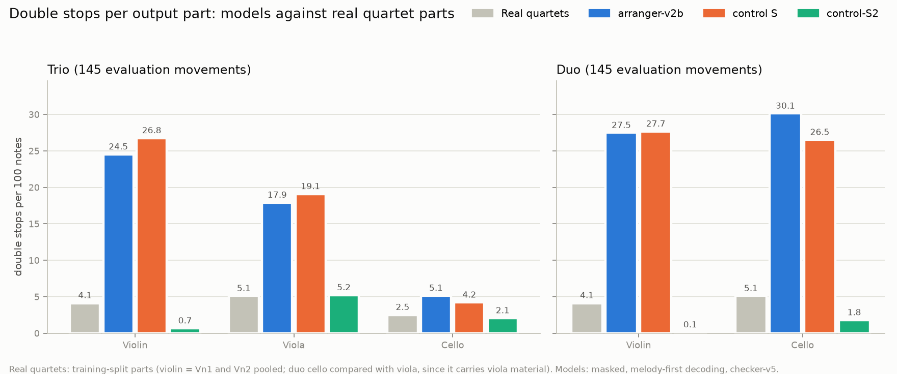
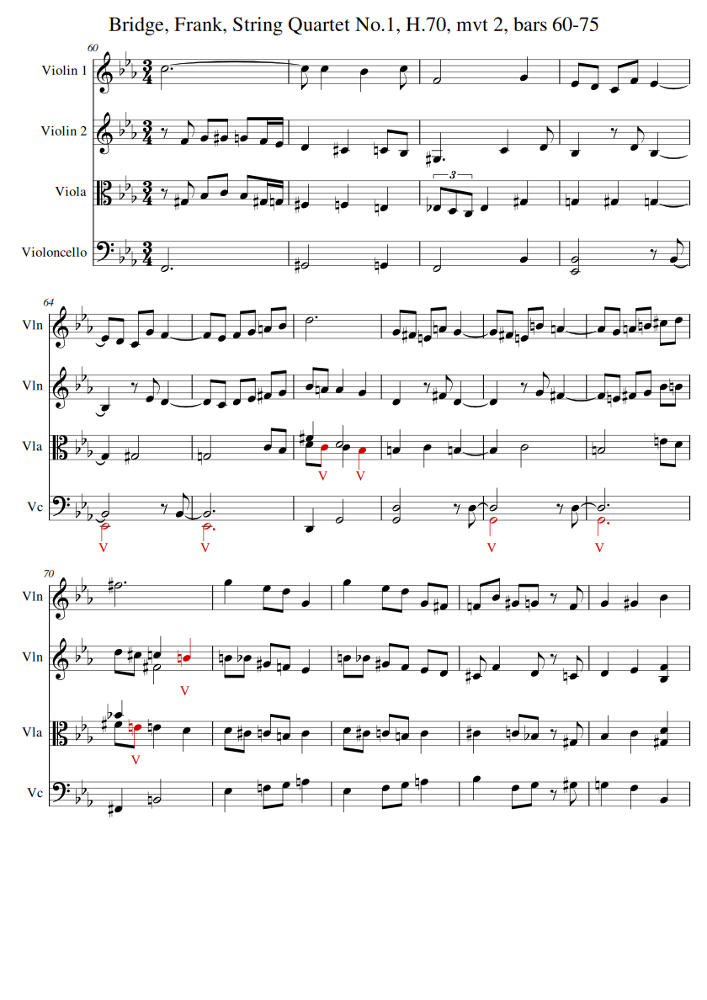
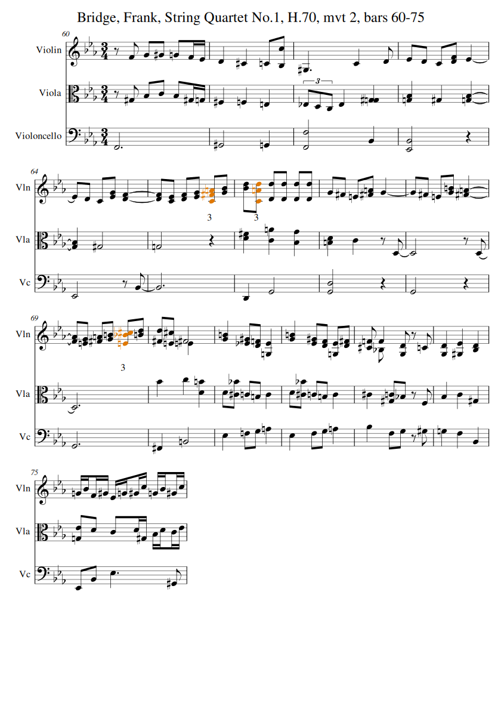
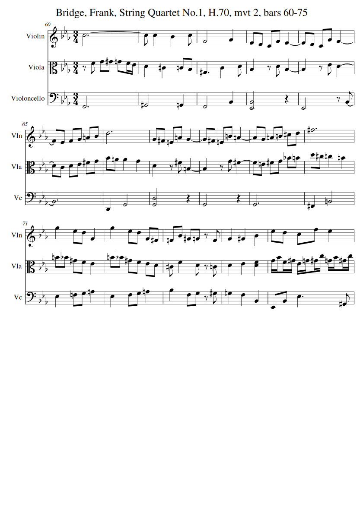

# Week summary, 2026-10-12 to 10-15: playable, idiomatic string reductions

**In one paragraph.** We tried to make a string-reduction model (quartet → trio or duo) that writes
playable parts by itself, rather than having violations clipped afterwards.
- **Reinforcement learning (GRPO)** improved which notes survive, but never removed the
  double-stop-heavy texture, and it kept finding reward loopholes.
- **What worked was changing the supervised training target.** The new S2 target follows the
  priorities from your MuseScore reviews: keep the melody; move, re-voice or drop inner voices
  rather than double-stop them; don't push moved cello notes into 6th position.
- **The model trained on it, control-S2:**
  - writes double stops at real-quartet rates (violin 0.7 per 100 notes, against 24.5 before);
  - keeps the melody (99%), including held notes;
  - needs the playability checker on only about 1% of notes.
- **The price is the inner voices,** which are dropped. On the frozen confirmatory test (145
  evaluation movements), it meets the user-priority criterion in the duo and misses it in the trio by
  a hair (viola double stops 5.2 per 100 notes against a real-viola 5.1).

---

## 1. The systems

| System | What it is |
|---|---|
| **Real quartets** | Reference only: the actual parts of the 476 training quartets. Used for "how often do real string parts double-stop?". |
| **Ou et al., masked** | A published neural arranger (NeurIPS 2025) that *generates* new notes, run with our playability checker as a mask. The external baseline. |
| **arranger-v2b** | Our transformer arranger (4.9M parameters, trained from scratch), supervised on the literal reduction (Vn1 + Vn2 → violin, and so on). The starting point for everything this week. |
| **control S** | v2b fine-tuned (supervised) on the literal reduction made playable by the checker. |
| **control-S2** | v2b fine-tuned (supervised) on the **S2 target**: melody first, inner voices moved, re-voiced or dropped instead of double-stopped, cello moves kept below 6th position. **The current best model.** |
| rl-A, rl-C, rl-SA, rl-SA2Z, … | The GRPO runs of this week (§5). They are development results, not in the main table. |

All model rows are masked (0 hard violations by construction), decoded with melody-first decoding, and
checked under checker-v5, on the 145 evaluation movements (the 5 movements reviewed by ear excluded).

## 2. The metrics

| Metric | Meaning | Better |
|---|---|---|
| **Interventions** | Share of notes whose top choice the checker had to block during decoding. Low means the model has learned the constraint itself. | lower |
| **Unmasked violations / 100 notes** | Rule violations in what the model writes *before* the checker steps in. | lower |
| **Double stops / 100 notes** (per part) | Onsets in a part where 2+ notes sound at once. Compare with the real-quartet row. | ≈ real |
| **Melody kept (count)** | Share of top-voice source notes reproduced (same pitch, onset within a 16th, any part). | higher |
| **Melody kept (duration)** | The same, weighted by note length, so held melody notes count fully. | higher |
| **Inner kept** | Share of inner-voice source notes reproduced. This is what S2 trades away. | higher |
| **Drops** | Share of source notes the model left out. | context |
| **Note_i F1** | Note-level match with the source *including which instrument plays it* (Ou et al.'s metric). | higher |
| **Harmony** | Per-beat agreement of pitch-class content with the source (0–1). | higher |
| **Note ratio** | Output notes ÷ source notes. | context |

## 3. Results table (confirmatory test, 145 evaluation movements)

### Trio (violin, viola, cello)

| System | Interventions | Unmasked viol. / 100 | DS violin | DS viola | DS cello | Melody (count) | Melody (dur.) | Inner kept | Drops | Note_i F1 | Harmony | Note ratio |
|---|---|---|---|---|---|---|---|---|---|---|---|---|
| *Real quartets* | — | — | *4.1* (Vn1 2.3, Vn2 6.1) | *5.1* | *2.5* | — | — | — | — | — | — | — |
| Ou et al., masked | — | — | 21.8 | 19.7 | 20.5 | 0.703 | 0.733 | 0.532 | — | 0.406 | 0.706 | 0.822 |
| arranger-v2b | 0.113 | 34.9 | 24.5 | 17.9 | 5.1 | 0.967 | 0.962 | 0.869 | 0.062 | 0.739 | **0.980** | 0.959 |
| control S | 0.038 | 8.8 | 26.8 | 19.1 | 4.2 | 0.969 | 0.955 | **0.902** | 0.054 | **0.771** | 0.977 | 0.967 |
| **control-S2** | **0.013** | **3.0** | **0.7** | **5.2** | **2.1** | **0.994** | **0.994** | 0.547 | 0.184 | 0.618 | 0.944 | 0.787 |

### Duo (violin, cello)

| System | Interventions | Unmasked viol. / 100 | DS violin | DS cello | Melody (count) | Melody (dur.) | Inner kept | Drops | Note_i F1 | Harmony | Note ratio |
|---|---|---|---|---|---|---|---|---|---|---|---|
| *Real quartets* | — | — | *4.1* | *5.1* (viola rate: the duo cello carries viola material) | — | — | — | — | — | — | — |
| Ou et al., masked | — | — | 26.7 | 27.2 | 0.654 | 0.699 | 0.471 | — | 0.379 | 0.674 | 0.623 |
| arranger-v2b | 0.220 | 57.7 | 27.5 | 30.1 | 0.953 | 0.948 | 0.537 | 0.217 | 0.612 | **0.931** | 0.803 |
| control S | 0.047 | 13.4 | 27.7 | 26.5 | 0.949 | 0.919 | **0.599** | 0.198 | **0.659** | 0.920 | 0.821 |
| **control-S2** | **0.010** | **3.1** | **0.1** | **1.8** | **0.971** | **0.967** | 0.028 | 0.426 | 0.602 | 0.857 | 0.548 |

The interventions and unmasked-violation columns don't apply to Ou et al.: its masking works on
generated tokens, not on note decisions.

## 4. Figure: double stops per part

v2b and control S double-stop **4–10× more often** than real string parts. control-S2 is at or below
the real rates in every part except the trio viola, which is level with it (5.2 against 5.1).

## 5. The confirmatory test (pre-registered, frozen before decoding)

| control-S2 vs v2b | Trio | Duo |
|---|---|---|
| **Criterion B** (your priorities): double stops ≤ real-part rates (CI upper); melody non-inferior; interventions lower; no rhythm rewriting | ✗, one item: viola double stops 5.2 [4.4, 6.1] against 5.1. ✓ for the other three. | **✓, all four** |
| Criterion A (the original "keep more notes" criterion) | ✗ (fidelity, harmony, note ratio), as anticipated | ✗, as anticipated |

Criterion A was written when keeping notes was the goal. It fails S2 by design, because S2 drops inner
voices as you approved. Both criteria were fixed before the decode and are reported unchanged.

## 6. Bridge, String Quartet No. 1, mvt 2, bars 60–75

**Bridge's quartet:**

**arranger-v2b trio (before):** merged double stops throughout the violin and viola.

**control-S2 trio (now):**

*The v2b render is from before checker-v5 (decode v2, normal commit order). The control-S2 render
uses checker-v5 and melody-first decoding. Bridge is one of the 5 review movements, so it is not in
the confirmatory test.*

### What changed, bar by bar (from DIFFERENCES.md)

| Source part | Kept | Moved | Re-voiced (octave) | Dropped | In the trio |
|---|---|---|---|---|---|
| **Violin 1** (melody) | 58 / 58 | — | — | **0** | The trio violin part, complete and as written, held notes included |
| **Violin 2** | — | 70 (→ viola) | 1 (→ cello, bar 74) | 2 | The trio **viola** part, same pitches |
| **Viola** | 3 | 1 (→ cello) | 6 | **55** | Almost entirely gone; a few notes re-homed by octave |
| **Cello** | 36 | — | — | 4 | The bass, essentially intact |

| Bar | Violin (from Vn1) | Viola (from Vn2) | Cello | What is lost or changed |
|---|---|---|---|---|
| 60 | held C5 (3½ beats) kept | Vn2's eighths F4 G4 G♯4 G4 F4 E♭4 | kept | Bridge's viola eighths (G♯3 B♭3 C4 B♭3 G♯3 G3) dropped |
| 61–64 | kept | Vn2's line | kept (one low B♭2 dropped in bar 63) | the viola's descending lines dropped |
| 65 | kept | C4 D4 E♭4 F♯4 G4 | low E♭2 dropped | viola's B♭3 re-voiced up into the violin |
| 66 | kept | B♭4 A4 A4 G4 | kept | viola's D4 re-voiced down two octaves into the cello |
| 67–69 | kept | Vn2's line | two D3s dropped | most of the viola dropped; one viola note up into the violin (bar 69) |
| 70 | **held F♯5 kept for the whole bar** | D5 C♯5 C5 B4 | kept | viola's F♯4 moved to the cello (F♯2); Vn2's held F♯4 dropped |
| 71–72 | kept | B4 B♭4 G♯4 F4 E♭4 | kept | the viola's chromatic descent (D4 C♯4 C4 B3 C4) dropped |
| 73–75 | kept | Vn2's line, sixteenths in 75 | kept | one viola note to the cello; the viola's sixteenths dropped |

**Musically:**
- The melody and bass are fully intact, including the held notes earlier models lost (the C5 in bar 60
  and the F♯5 in bar 70).
- The trio viola is Bridge's second violin, comfortably in range.
- **Bridge's own viola line is the casualty,** most audibly the inner motion under the melody (bars
  60–62) and the chromatic descent (bars 71–72).
- There are no double stops apart from two short cello dyads from Bridge's own cello part.

## 7. What RL taught us (development results)

| Run | Idea | What happened |
|---|---|---|
| rl-A, rl-C | GRPO from v2b, fidelity and double-stop reward | Melody retention up; checker interventions not down. **rl-C hack:** split held notes into repeats (note ratio 1.07). |
| rl-SA | GRPO from control S | Best fidelity, but gave back part of S's playability. |
| rl-AZ / rl-AZ2 | Plus a feasibility term | **Hacks:** dropped 60% of notes (AZ); re-struck 17% of notes as repeats (AZ2). |
| rl-SA2Z / rl-SA3Z | From S, feasibility term, anti-repeat rule, λ_DS 1 / 3 | Closest to passing. λ = 3 cut double stops only by dropping notes. |
| rl-SM2Z / rl-SM3Z | Duration-weighted melody, octave-relocation credit | Small gains; neither passed the dev-split selection. |

**Lessons:**
1. A reward that measures only preservation invites loopholes. Every penalty moved the problem
   somewhere else; the fixed detectors caught each hack.
2. Under a permanent mask, the RL objective gives no gradient to unplayable choices, so RL alone
   doesn't internalise the constraint.
3. The decoding commit order matters musically. Melody-first decoding saved held melody notes.
4. Changing the supervision (S2) did what RL didn't.

## 8. Proposed next step (Block 5): a learned "idiomatic part" term

**What's missing.** Nothing in the objective asks whether each part looks like something a violinist,
violist or cellist would be given.

**The proposal: a small part model**, 2–3M parameters, a causal transformer of 4 layers × 256:
- **Training data:** the real parts of the 476 training quartets, next-event prediction.
- **Events:** pitch interval, register, duration, held against re-struck, number of voices sounding,
  and beat position, plus an instrument token.
- **Score:** each output part's mean log-likelihood, as a z-score against real dev parts of the same
  instrument.
- **Validated before use:** it must rank, on the dev split, *real parts > control-S2 > v2b > hacked
  outputs*.
- **Then:** RL from control-S2 with reward = M fidelity + idiomatic term. Select on the dev split,
  freeze, and confirm once on the 145 movements.

**Safeguards against gaming it:** fidelity and retention floors, the KL anchor to control-S2, the fixed
detectors, and your listening reviews.

**Alternatives** if "inventing" notes matters (our model only reassigns, re-octaves, splits or
arpeggiates source notes):
- extend the realisation vocabulary with broken-chord figures, pedal tones and re-voiced chord tones;
- a generative fill for dropped inner voices;
- RL on Ou et al. itself under our mask and reward.

## 9. How to present these results

1. **The headline table** (§3), with the real-quartet row as the reference.
2. **The double-stop figure** (§4), the most persuasive single image.
3. **A trade-off plot:** interventions (x) against melody kept by duration (y), one point per
   system; S2 sits in the "playable and melodic" corner.
4. **Bridge 60–75 side by side** (§6), with your listening verdict.
5. **"What went wrong":** the reward-hack table (§7) and its lessons.

**Always state alongside:**
- the development RL runs were tuned with evaluation-set results (REVIEW R39); only the pre-registered
  runs and the confirmatory test are clean evidence;
- S2 deliberately trades inner voices for playability, and in the duo almost all inner material goes.

## 10. Caveats and open items

- **Duo trade-off:** inner retention 0.03 and harmony 0.857, against v2b's 0.931. The duo arrangement
  is essentially melody plus bass.
- **Trio viola double stops** are at the real-viola rate, not below it (criterion B item 1).
- **Unconfirmed thresholds:** the cello "6th position" ceiling (G4, U20) and normal against extended
  position for cello triple stops are yours to confirm.
- **Scope of "real" rates:** they come from quartet parts; trio literature isn't in the corpus.

*Sources: `model/results/confirm/CONFIRM.md`, `model/results/confirm/summary_table.json`, BLOCK4.md,
REVIEW.md (R28–R47), PROGRESS.md, and `decoding/results/examples/control-S2-trio/022_bars60-75/DIFFERENCES.md`.*
